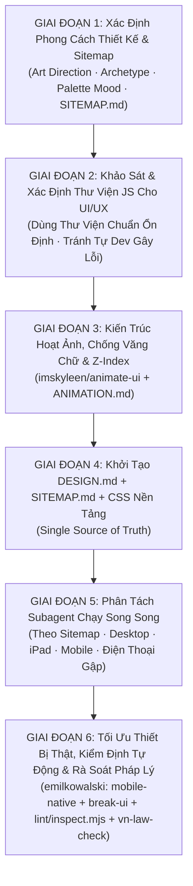

# 01. QUY TRÌNH ĐIỀU PHỐI ĐA AGENT XÂY DỰNG WEBSITE (`01_AGENT_WORKFLOW.md`)

Tài liệu này quy định luồng làm việc 6 giai đoạn từ lúc nhận yêu cầu đến khi hoàn thiện website đa trang, đảm bảo tính sáng tạo mở về thẩm mỹ, tính ổn định tuyệt đối về kỹ thuật và tối ưu tốc độ triển khai nhờ tận dụng thư viện chuẩn.



---

## GIAI ĐOẠN 1: Xác Định Phong Cách Thiết Kế & Lập Kế Hoạch Sitemap

### 1.1. Bộ Skill Kích Hoạt (Cài Đặt Hoặc Đọc Từ GitHub)
- **`design-taste-frontend` (`taste-skill`):** [`https://github.com/Leonxlnx/taste-skill`](https://github.com/Leonxlnx/taste-skill)
  - Lệnh cài đặt trên máy mới: `npx skills add https://github.com/Leonxlnx/taste-skill --skill "design-taste-frontend"`
- **`impeccable`:** [`https://github.com/pbakaus/impeccable`](https://github.com/pbakaus/impeccable)
  - Lệnh cài đặt trên máy mới: `npx skills add https://github.com/pbakaus/impeccable`

### 1.2. Quy Trình Thực Hiện
1. **Xác định Phong cách Thiết kế (`Art Direction / Archetype`):**
   - Phân tích kỹ ngành nghề, văn hóa thương hiệu và tệp người dùng mục tiêu.
   - Lead Agent chạy công cụ `draw.mjs` của `taste-skill` (hoặc chọn archetype đặc trưng: *Editorial Report, Swiss Precision, Kinetic Typography, Tactile Craft, Atmospheric Minimal, Architectural Grid, High-Contrast Studio...*) để định hình ngôn ngữ thị giác riêng, **tuyệt đối không sao chép lại bố cục hay bảng màu của các dự án cũ**:
     ```bash
     node <path-to-taste-skill>/scripts/draw.mjs --brief "<mô tả ngành nghề và cá tính thương hiệu>"
     ```
2. **Thiết lập Hệ thống Token Màu Ngữ Nghĩa Mở (Xem chi tiết tại [`02_DESIGN_SYSTEM_TEMPLATE.md`](02_DESIGN_SYSTEM_TEMPLATE.md)):**
   - Chỉ khóa **vai trò ngữ nghĩa** của màu (`--bg`, `--surface`, `--ink`, `--muted`, `--field-primary`, `--field-primary-deep`, `--field-contrast`, `--accent`, `--accent-ink`), cho phép tự do sáng tạo sắc thái (tông ấm, tông đá trầm, tông đất, tông công nghệ hoặc đơn sắc) miễn đạt độ tương phản WCAG AA/AAA.
3. **Lựa chọn Cặp Font Chữ & Hệ Thống Typography:**
   - Chọn Display Font (ấn tượng, truyền tải linh hồn thương hiệu) + Text Font (dễ đọc ở mọi kích thước, hỗ trợ tiếng Việt hoàn chỉnh). Toàn bộ nhúng tự chủ nội bộ (`Self-hosted .woff2`).
4. **Hoạch định `SITEMAP.md` (Bắt buộc quy hoạch cả các Trang Pháp Lý với Layout Độc Bản ngay từ đầu):**
   - Liệt kê danh sách toàn bộ các trang HTML cần xây dựng, mục tiêu chuyển đổi của từng trang, cấu trúc phân đoạn (Chapters/Sections) và thành phần tương tác thật (`data-ui="..."`) trên mỗi trang.
   - **BẮT BUỘC đưa các Trang Pháp Lý Việt Nam vào `SITEMAP.md` ngay từ Giai đoạn 1** (dựa trên phân loại website từ [`05_VN_LEGAL_COMPLIANCE.md`](05_VN_LEGAL_COMPLIANCE.md)):
     - Mọi website có biểu mẫu thu thập thông tin bắt buộc có trang **`chinh-sach-bao-mat.html` (Quy chế Bảo vệ Dữ liệu Cá nhân & Pháp lý)**.
     - Website Thương mại điện tử / Bán hàng / Dịch vụ có thu phí bắt buộc quy hoạch thêm trang/phân khu **Điều khoản giao dịch, Chính sách thanh toán, vận chuyển & đổi trả**.
   - **Quy tắc Thiết kế Layout riêng cho Trang Pháp Lý ngay từ Sitemap:** Tuyệt đối **CẤM dùng lại (`copy-paste`) layout trang phụ thông thường (`subpage-masthead`)** cho các trang pháp lý. Ngay trong `SITEMAP.md`, trang pháp lý phải được thiết kế theo **Kiến trúc Văn kiện Pháp chế & Hồ sơ Tuân thủ độc bản (`Legal Charter & Dossier Layout`)** gồm: Masthead văn kiện đóng dấu hiệu lực, Băng thông số thời hạn pháp định (`SLA Band`), Không gian đọc 2 cột có Mục lục neo cố định bên trái + Luồng điều khoản & Bảng kiểm toán bên phải, và Trạm tương tác thực hiện quyền chủ thể dữ liệu.

---

## GIAI ĐOẠN 2: Khảo Sát & Xác Định Thư Viện JS Cho Các Tính Năng UI/UX (Tránh Tự Dev Gây Lỗi)

### 2.1. Nguyên Tắc Cốt Lõi: Không Tự Phát Minh Lại Bánh Xe (`No Reinventing Complex UI Wheels`)
- **Vấn đề cốt lõi:** Khi xây dựng các tính năng tương tác UI/UX nâng cao (như Lightbox xem ảnh kèm phóng to 1x–3x và kéo pan, Carousel/Slider cảm ứng vuốt trượt có quán tính, Dropdown lọc tìm kiếm, Ngăn kéo trượt, Toast thông báo...), **việc lập trình viên tự code JS thủ công từ số 0 thường phát sinh rất nhiều lỗi tiềm ẩn:**
  - Lỗi xung đột sự kiện chuột/chạm (cuộn qua trái rồi qua phải thì nút phóng to bị đơ hoặc kẹt cử chỉ).
  - Lỗi giật khung hình (jank/stutter) trên iPhone và điện thoại Android thật.
  - Lỗi vỡ giao diện khi người dùng thao tác nhanh hoặc đổi kích thước màn hình đột ngột.
  - Tốn kém thời gian dev và bảo trì không cần thiết.
- **Quy tắc bắt buộc:** **Lead Agent BẮT BUỘC khảo sát và xác định danh sách các thư viện JS tiêu chuẩn công nghiệp ngay từ đầu cho toàn bộ tính năng UI/UX của dự án**, thay vì để các Subagent tự dev chắp vá bằng tay.

### 2.2. Danh Mục Thư Viện JS Tiêu Chuẩn Được Khuyến Nghị
Tùy vào tính năng UI/UX được quy hoạch trong `SITEMAP.md`, Agent chọn thư viện chuyên dụng, nhẹ, không phụ thuộc jQuery, đã được cộng đồng quốc tế kiểm thử độ ổn định cao:

| Phân Nhóm Tính Năng UI/UX | Thư Viện Khuyến Nghị | Ưu Điểm & Khả Năng Vượt Trội |
| :--- | :--- | :--- |
| **1. Lightbox / Image Zoom / Panzoom** | **Fancybox v5 (`@fancyapps/ui` v5)** | Chuẩn công nghiệp: Hỗ trợ 5 thao tác tương tác hoàn hảo (click 1 phóng to 3x, click 2 thu nhỏ 1x, cuộn wheel zoom mượt, kéo pan khi phóng to, vuốt swipe chuyển ảnh khi 1x). |
| **2. Carousel / Slider / Vuốt Chạm** | **Embla Carousel** hoặc **Swiper** | Siêu mượt trên cảm ứng di động, không gây layout shift, hỗ trợ loop, autoplay và pagination hoàn hảo. |
| **3. Cuộn Mượt Trọng Lực (Smooth Scroll)** | **Lenis** | Cuộn mượt tự nhiên, nhẹ, tích hợp tốt với scrollbar gốc và không phá vỡ cử chỉ touch trên mobile. |
| **4. Hộp Thoại Thông Báo (Toasts)** | **Sonner** | Hỗ trợ xếp chồng (stack) thông minh, tự động biến mất, hỗ trợ cử chỉ vuốt tắt trên điện thoại. |
| **5. Bộ Lọc & Dropdown Nâng Cao** | **Tom Select** hoặc **Choices.js** | Thuần Vanilla JS, nhẹ, hỗ trợ tìm kiếm tức thì, chọn nhiều mục (multi-select) mà không cần jQuery. |
| **6. Hoạt Ảnh Tương Tác & Vi Chuyển Động** | **Motion** (Framer Motion / Motion One) | Gia tốc vật lý chân thực, chạy trên Web Animations API / compositor thread, không tụt khung hình. |
| **7. Hệ Thống Biểu Tượng (Icons)** | **Lucide Icons** hoặc **Phosphor Icons** | Bộ SVG sắc nét, đồng nhất độ dày nét (stroke-width), dễ dàng tùy biến màu theo biến CSS. |

### 2.3. Ba Quy Tắc Bắt Buộc Khi Sử Dụng Thư Viện JS
1. **Lưu trữ Cục Bộ Tuyệt Đối (`Self-Hosted Local Assets`):**
   - Mọi file thư viện `.js` và `.css` phải được tải về lưu trực tiếp tại thư mục `assets/vendor/<tên-thư-viện>/` của dự án.
   - **TUYỆT ĐỐI KHÔNG DÙNG LINK CDN BÊN NGOÀI** (`cdnjs`, `unpkg`, `jsdelivr`...) để đảm bảo trang tải tức thì, không bị lỗi mạng làm đơ tính năng và vượt qua vòng kiểm tra `lint.mjs`.
2. **Tùy Biến Thiết Kế Giao Diện (`Custom UI Skinning`):**
   - Không được phép để giao diện mặc định thô cứng của thư viện.
   - Bắt buộc ghi đè CSS (sử dụng biến CSS chính thức của thư viện như `--f-button-*` của Fancybox hoặc viết CSS override) để toàn bộ nút bấm, thanh điều hướng, bo góc, màu sắc và font chữ đồng bộ 100% với hệ thống `DESIGN.md`.
3. **Bản Địa Hóa Tiếng Việt (`Vietnamese Localization`):**
   - Mọi tooltip, thông báo lỗi, nút điều hướng của thư viện phải được cấu hình sang tiếng Việt (ví dụ `l10n` trong Fancybox: *Đóng (Esc)*, *Ảnh tiếp theo*, *Phóng to / Thu nhỏ*...).

---

## GIAI ĐOẠN 3: Thiết Kế Hoạt Ảnh, Chống Văng Chữ & Thống Nhất `z-index` (`imskyleen/animate-ui`)

### 3.1. Bộ Skill Kích Hoạt (Cài Đặt Hoặc Đọc Từ GitHub)
- **`animate-ui`:** [`https://github.com/imskyleen/animate-ui`](https://github.com/imskyleen/animate-ui)
  - Lệnh cài đặt trên máy mới: `npx skills add https://github.com/imskyleen/animate-ui`
  - Tham chiếu bắt buộc trong skill: `references/motion-rules.md`, `references/tokens.md`, `references/recipes.md`.

### 3.2. Quy Trình Thực Hiện (Xem chi tiết tại [`03_ANIMATION_AND_ZINDEX.md`](03_ANIMATION_AND_ZINDEX.md))
1. **Định nghĩa thông số chuyển động:**
   - Xác định rõ hoạt ảnh xuất hiện (`Enter`), kết thúc (`Exit`), chuyển đổi tại chỗ (`Swap/Morph`), phản hồi nhấn (`Press`), thời lượng (`Duration`), đường cong gia tốc (`Easing`) và quy mô biến đổi (`Scale / Blur / Shift`).
2. **Kê khai phần tử bị ảnh hưởng bên trong & bên ngoài (`Internal & External Impact`):**
   - Mỗi hoạt ảnh phải được thống kê vào `ANIMATION.md`: khi chạy sẽ tác động tới phần tử con nào bên trong và đẩy/co giãn phần tử anh em nào bên ngoài.
3. **Áp dụng Luật Chống Văng / Dồn Chữ Khi Khung Co Giãn (`Anti-Text-Scattering Law`):**
   - Mọi thẻ có kích thước biến đổi (accordion ngang/dọc, tab co giãn, dải ảnh mở rộng) bắt buộc phải ẩn chữ tức thì (`opacity: 0; transition: none`) hoặc khóa `min-width` trước khi khung di chuyển, và chỉ hiện chữ lại sau khi khung đã dừng hẳn.
4. **Khóa thang `z-index` 9 tầng trong `:root`:**
   - Cấm viết số `z-index` tùy ý rải rác trong CSS để các lớp sticky header, nút nổi, ngăn kéo (drawer), menu di động và lightbox không bao giờ đè lấn nhau.

---

## GIAI ĐOẠN 4: Chốt `DESIGN.md` & Khung CSS Dùng Chung Trước Khi Tách Subagent

Trước khi gọi bất kỳ Subagent nào, **Lead Agent** phải hoàn tất:
1. `DESIGN.md` — Chứa toàn bộ token màu, typography, ma trận nút bấm, danh sách thư viện JS đã chọn kèm thông số custom CSS, thang `z-index`, quy tắc hoạt ảnh, ma trận responsive và **kiến trúc layout riêng biệt cho từng nhóm trang (Trang chủ, Trang nội dung/danh mục, và Trang Văn kiện Pháp lý độc bản)**.
2. `SITEMAP.md` — Chứa cấu trúc từng trang (bao gồm đầy đủ các trang pháp lý bắt buộc) và liên kết điều hướng thống nhất ở cả Header lẫn Footer.
3. `css/styles.css` — Chứa toàn bộ biến `:root`, hệ thống lưới, kiểu nút bấm, chuẩn hóa biểu mẫu (`.member-form-row` / `.member-form-field`, `.member-form-consent`), custom CSS cho các thư viện JS và **toàn bộ hệ thống class CSS của Layout Văn kiện Pháp lý (`.legal-charter-hero`, `.legal-dossier-stamp`, `.legal-sla-band`, `.legal-workspace-section`, `.legal-index-rail`, `.legal-clauses-stream`, `.legal-clause-card`, `.legal-rights-section`)**.

> **Lý do bắt buộc:** Khi `DESIGN.md`, `SITEMAP.md`, danh mục thư viện JS và `css/styles.css` đã được định nghĩa sẵn làm nguồn chuẩn duy nhất (*Single Source of Truth*), các Subagent chạy song song sẽ tạo ra các trang đồng nhất 100%, không bị xung đột CSS và không bao giờ tự dev lại các tính năng UI/UX đã có thư viện chuẩn.

---

## GIAI ĐOẠN 5: Phân Tách Subagent Chạy Song Song Theo Sitemap & Đa Thiết Bị

Sử dụng công cụ `invoke_subagent` để tách công việc thành các Subagent độc lập, **mỗi Subagent chỉ sở hữu danh sách file riêng biệt**:

### 5.1. Phân Tách Theo Sitemap & Logic Tương Tác
- **Subagent 1 (`Homepage & Core Interactive JS Architect`):**
  - Phụ trách `index.html` và `js/main.js` (toàn bộ bộ lọc tương tác, điều khiển hoạt ảnh chống văng chữ, menu di động, khởi tạo thư viện JS tiêu chuẩn, kiểm tra đồng ý dữ liệu cá nhân trên form, và logic điều hướng mục lục pháp lý).
- **Subagent 2 (`Brand Story / About Page Builder`):**
  - Phụ trách trang giới thiệu / câu chuyện thương hiệu / năng lực cốt lõi.
- **Subagent 3 (`Catalog / Projects / Events Archive Builder`):**
  - Phụ trách trang danh mục sản phẩm / dự án / sự kiện kèm bộ lọc trực tiếp và thư viện ảnh có tích hợp Fancybox v5 Local.
- **Subagent 4 (`Conversion / Membership / Contact Builder`):**
  - Phụ trách các trang biểu mẫu chuyển đổi, đối tác, FAQ và liên hệ.
- **Subagent 5 (`Legal Charter & Compliance Dossier Builder`):**
  - Phụ trách các trang pháp lý (`chinh-sach-bao-mat.html`, điều khoản hoạt động...) sử dụng **Layout Văn kiện Hiến chương Pháp lý độc bản** đã được quy hoạch trong `SITEMAP.md` và `css/styles.css`, tuyệt đối không sao chép lại layout của các trang nội dung thông thường.

### 5.2. Ma Trận 5 Dải Thiết Bị Bắt Buộc Mọi Subagent Phải Đảm Bảo
1. **Desktop & Widescreen (`1280px – 1920px+`)**
2. **iPad Mini / iPad Air / iPad Pro (`768px – 1024px`)**
3. **Điện Thoại Gập — Màn Hình Chính Khi Mở (`Foldable Unfolded`: `641px – 900px`)**
4. **Điện Thoại Di Động Chuẩn (`iPhone / Android`: `360px – 640px`)**
5. **Điện Thoại Gập — Màn Hình Phụ Khi Gập (`Foldable Cover Screen`: `280px – 359px`)**

---

## GIAI ĐOẠN 6: Tối Ưu Thiết Bị Thật, Kiểm Định Tự Động & Rà Soát Pháp Lý Việt Nam

Sau khi các Subagent hoàn thành, kích hoạt bộ skill từ [`https://github.com/emilkowalski/skill`](https://github.com/emilkowalski/skill) (xem [`04_REAL_DEVICE_AND_FOLDABLE.md`](04_REAL_DEVICE_AND_FOLDABLE.md)) kết hợp quy trình tuân thủ pháp luật Việt Nam (xem [`05_VN_LEGAL_COMPLIANCE.md`](05_VN_LEGAL_COMPLIANCE.md)):
1. **`mobile-native`:** Xử lý tràn ngang trên Safari iOS / Chrome Android thật (`overflow-x: clip` trên cả `html` và `body`), vùng tai thỏ `safe-area-inset`, chiều cao động `100svh`/`100dvh`, và khóa `:hover` bằng `@media (hover: hover) and (pointer: fine)`.
2. **`break-ui`:** Thử nghiệm phá giao diện bằng chuỗi văn bản dài, email không dấu cách, màn hình siêu hẹp `280px–320px` và thao tác co kéo liên tục.
3. **`emil-design-eng` & `animation-performance`:** Đảm bảo phản hồi chạm tức thì (`touch-action: manipulation`, `:active` `scale(0.97)`) và giữ tốc độ khung hình `60fps/120fps`.
4. **Rà soát Tuân thủ Pháp luật Việt Nam (`05_VN_LEGAL_COMPLIANCE.md`):** Tham khảo checklist [`https://github.com/mhfed/vn-law-check`](https://github.com/mhfed/vn-law-check) kết hợp **bắt buộc chủ động tìm kiếm trực tuyến (`search_web`) các Luật, Nghị định, Thông tư mới nhất vừa ban hành** (không phụ thuộc 1 nguồn duy nhất) để kiểm tra biểu mẫu thu thập dữ liệu cá nhân, thông tin pháp nhân ở `Footer`, điều khoản giao dịch và nội dung quảng cáo.
5. **Chạy kiểm tra tự động `lint.mjs` và `inspect.mjs`:** Đạt **`0 FAIL, 0 WARN`** ở cả 3 độ rộng chuẩn (`1440px`, `768px`, `390px`) trước khi bàn giao hoặc triển khai.
