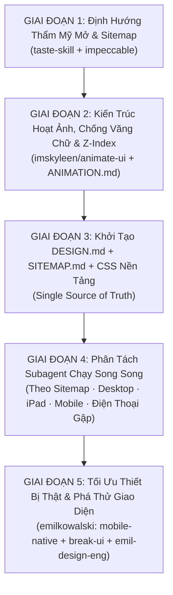

# 01. QUY TRÌNH ĐIỀU PHỐI ĐA AGENT XÂY DỰNG WEBSITE (`01_AGENT_WORKFLOW.md`)

Tài liệu này quy định luồng làm việc 5 giai đoạn từ lúc nhận yêu cầu đến khi hoàn thiện website đa trang, đảm bảo tính sáng tạo mở về thẩm mỹ nhưng chặt chẽ tuyệt đối về kỹ thuật.



---

## GIAI ĐOẠN 1: Định Hướng Thẩm Mỹ Mở & Lập Kế Hoạch Sitemap (`taste-skill` + `impeccable`)

### 1.1. Bộ Skill Kích Hoạt (Cài Đặt Hoặc Đọc Từ GitHub)
- **`design-taste-frontend` (`taste-skill`):** [`https://github.com/Leonxlnx/taste-skill`](https://github.com/Leonxlnx/taste-skill)
  - Lệnh cài đặt trên máy mới: `npx skills add https://github.com/Leonxlnx/taste-skill --skill "design-taste-frontend"`
- **`impeccable`:** [`https://github.com/pbakaus/impeccable`](https://github.com/pbakaus/impeccable)
  - Lệnh cài đặt trên máy mới: `npx skills add https://github.com/pbakaus/impeccable`

### 1.2. Quy Trình Thực Hiện (Chống Lối Mòn Thiết Kế)
1. **Rút hướng nghệ thuật mới (`draw.mjs`) phù hợp với lĩnh vực dự án:**
   - Thay vì lặp lại một kiểu bố cục hay một tông màu cố định, Lead Agent chạy công cụ `draw.mjs` của `taste-skill` (hoặc chọn từ thư viện archetype: *Editorial Report, Swiss Precision, Kinetic Typography, Tactile Craft, Atmospheric Minimal, Architectural Grid, High-Contrast Studio...*) dựa trên tính chất thương hiệu của khách hàng:
     ```bash
     node <path-to-taste-skill>/scripts/draw.mjs --brief "<mô tả ngành nghề và cá tính thương hiệu>"
     ```
2. **Thiết lập Hệ thống Token Màu mở (Xem chi tiết tại [`02_DESIGN_SYSTEM_TEMPLATE.md`](02_DESIGN_SYSTEM_TEMPLATE.md)):**
   - Chỉ khóa **vai trò ngữ nghĩa** của màu (`--bg-primary`, `--bg-surface`, `--text-primary`, `--text-muted`, `--brand-primary`, `--brand-accent`), để mỗi dự án tự do sáng tạo sắc thái màu (tông ấm, tông lạnh, tông đất, tông đơn sắc, hoặc tương phản cao) miễn đạt chuẩn độ tương phản WCAG AA/AAA.
3. **Hoạch định `SITEMAP.md` (Bắt buộc quy hoạch cả các Trang Pháp Lý với Layout Độc Bản ngay từ đầu):**
   - Liệt kê danh sách toàn bộ các trang HTML cần xây dựng, mục tiêu chuyển đổi của từng trang, cấu trúc phân đoạn (Chapters/Sections) và thành phần tương tác thật (`data-ui="..."`) trên mỗi trang.
   - **BẮT BUỘC đưa các Trang Pháp Lý Việt Nam vào `SITEMAP.md` ngay từ Giai đoạn 1** (dựa trên phân loại website từ [`05_VN_LEGAL_COMPLIANCE.md`](05_VN_LEGAL_COMPLIANCE.md)):
     - Mọi website có biểu mẫu thu thập thông tin bắt buộc có trang **`chinh-sach-bao-mat.html` (Quy chế Bảo vệ Dữ liệu Cá nhân & Pháp lý)**.
     - Website Thương mại điện tử / Bán hàng / Dịch vụ có thu phí bắt buộc quy hoạch thêm trang/phân khu **Điều khoản giao dịch, Chính sách thanh toán, vận chuyển & đổi trả**.
   - **Quy tắc Thiết kế Layout riêng cho Trang Pháp Lý ngay từ Sitemap:** Tuyệt đối **CẤM dùng lại (`copy-paste`) layout trang phụ thông thường (`subpage-masthead`)** cho các trang pháp lý. Ngay trong `SITEMAP.md`, trang pháp lý phải được thiết kế theo **Kiến trúc Văn kiện Pháp chế & Hồ sơ Tuân thủ độc bản (`Legal Charter & Dossier Layout`)** gồm: Masthead văn kiện đóng dấu hiệu lực, Băng thông số thời hạn pháp định (`SLA Band`), Không gian đọc 2 cột có Mục lục neo cố định bên trái + Luồng điều khoản & Bảng kiểm toán bên phải, và Trạm tương tác thực hiện quyền chủ thể dữ liệu.

---

## GIAI ĐOẠN 2: Thiết Kế Hoạt Ảnh, Chống Văng Chữ & Thống Nhất `z-index` (`imskyleen/animate-ui`)

### 2.1. Bộ Skill Kích Hoạt (Cài Đặt Hoặc Đọc Từ GitHub)
- **`animate-ui`:** [`https://github.com/imskyleen/animate-ui`](https://github.com/imskyleen/animate-ui)
  - Lệnh cài đặt trên máy mới: `npx skills add https://github.com/imskyleen/animate-ui`
  - Tham chiếu bắt buộc trong skill: `references/motion-rules.md`, `references/tokens.md`, `references/recipes.md`.

### 2.2. Quy Trình Thực Hiện (Xem chi tiết tại [`03_ANIMATION_AND_ZINDEX.md`](03_ANIMATION_AND_ZINDEX.md))
1. **Định nghĩa thông số chuyển động:**
   - Xác định rõ hoạt ảnh xuất hiện (`Enter`), kết thúc (`Exit`), chuyển đổi tại chỗ (`Swap/Morph`), phản hồi nhấn (`Press`), thời lượng (`Duration`), đường cong gia tốc (`Easing`) và quy mô biến đổi (`Scale / Blur / Shift`).
2. **Kê khai phần tử bị ảnh hưởng bên trong & bên ngoài (`Internal & External Impact`):**
   - Mỗi hoạt ảnh phải được thống kê vào `ANIMATION.md`: khi chạy sẽ tác động tới phần tử con nào bên trong và đẩy/co giãn phần tử anh em nào bên ngoài.
3. **Áp dụng Luật Chống Văng / Dồn Chữ Khi Khung Co Giãn (`Anti-Text-Scattering Law`):**
   - Mọi thẻ có kích thước biến đổi (accordion ngang/dọc, tab co giãn, dải ảnh mở rộng) bắt buộc phải ẩn chữ tức thì (`opacity: 0; transition: none`) hoặc khóa `min-width` trước khi khung di chuyển, và chỉ hiện chữ lại sau khi khung đã dừng hẳn.
4. **Khóa thang `z-index` 9 tầng trong `:root`:**
   - Cấm viết số `z-index` tùy ý rải rác trong CSS để các lớp sticky header, nút nổi, ngăn kéo (drawer), menu di động và lightbox không bao giờ đè lấn nhau.

---

## GIAI ĐOẠN 3: Chốt `DESIGN.md` & Khung CSS Dùng Chung Trước Khi Tách Subagent

Trước khi gọi bất kỳ Subagent nào, **Lead Agent** phải hoàn tất:
1. `DESIGN.md` — Chứa toàn bộ token màu, typography, ma trận nút bấm, thang `z-index`, quy tắc hoạt ảnh, ma trận responsive và **kiến trúc layout riêng biệt cho từng nhóm trang (Trang chủ, Trang nội dung/danh mục, và Trang Văn kiện Pháp lý độc bản)**.
2. `SITEMAP.md` — Chứa cấu trúc từng trang (bao gồm đầy đủ các trang pháp lý bắt buộc) và liên kết điều hướng thống nhất ở cả Header lẫn Footer.
3. `css/styles.css` — Chứa toàn bộ biến `:root`, hệ thống lưới, kiểu nút bấm, chuẩn hóa biểu mẫu (`.member-form-row` / `.member-form-field`, `.member-form-consent`) và **toàn bộ hệ thống class CSS của Layout Văn kiện Pháp lý (`.legal-charter-hero`, `.legal-dossier-stamp`, `.legal-sla-band`, `.legal-workspace-section`, `.legal-index-rail`, `.legal-clauses-stream`, `.legal-clause-card`, `.legal-rights-section`)**.

> **Lý do bắt buộc:** Khi `DESIGN.md`, `SITEMAP.md` và `css/styles.css` đã định nghĩa sẵn đầy đủ cả trang nội dung lẫn trang pháp lý làm nguồn chuẩn duy nhất (*Single Source of Truth*), các Subagent chạy song song sẽ tạo ra các trang đồng nhất 100% mà không bao giờ bị thiếu class CSS hay phải dùng tạm layout của trang cũ.

---

## GIAI ĐOẠN 4: Phân Tách Subagent Chạy Song Song Theo Sitemap & Đa Thiết Bị

Sử dụng công cụ `invoke_subagent` để tách công việc thành các Subagent độc lập, **mỗi Subagent chỉ sở hữu danh sách file riêng biệt**:

### 4.1. Phân Tách Theo Sitemap & Logic Tương Tác
- **Subagent 1 (`Homepage & Core Interactive JS Architect`):**
  - Phụ trách `index.html` và `js/main.js` (toàn bộ bộ lọc tương tác, điều khiển hoạt ảnh chống văng chữ, menu di động, kiểm tra đồng ý dữ liệu cá nhân trên form, logic điều hướng mục lục/quyền pháp lý, và popup ảnh Fancybox v5 Local).
- **Subagent 2 (`Brand Story / About Page Builder`):**
  - Phụ trách trang giới thiệu / câu chuyện thương hiệu / năng lực cốt lõi.
- **Subagent 3 (`Catalog / Projects / Events Archive Builder`):**
  - Phụ trách trang danh mục sản phẩm / dự án / sự kiện kèm bộ lọc trực tiếp và thư viện ảnh.
- **Subagent 4 (`Conversion / Membership / Contact Builder`):**
  - Phụ trách các trang biểu mẫu chuyển đổi, đối tác, FAQ và liên hệ.
- **Subagent 5 (`Legal Charter & Compliance Dossier Builder`):**
  - Phụ trách các trang pháp lý (`chinh-sach-bao-mat.html`, điều khoản hoạt động...) sử dụng **Layout Văn kiện Hiến chương Pháp lý độc bản** đã được quy hoạch trong `SITEMAP.md` và `css/styles.css`, tuyệt đối không sao chép lại layout của các trang nội dung thông thường.

### 4.2. Ma Trận 5 Dải Thiết Bị Bắt Buộc Mọi Subagent Phải Đảm Bảo
1. **Desktop & Widescreen (`1280px – 1920px+`)**
2. **iPad Mini / iPad Air / iPad Pro (`768px – 1024px`)**
3. **Điện Thoại Gập — Màn Hình Chính Khi Mở (`Foldable Unfolded`: `641px – 900px`)**
4. **Điện Thoại Di Động Chuẩn (`iPhone / Android`: `360px – 640px`)**
5. **Điện Thoại Gập — Màn Hình Phụ Khi Gập (`Foldable Cover Screen`: `280px – 359px`)**

---

## GIAI ĐOẠN 5: Tối Ưu Thiết Bị Thật, Kiểm Định Tự Động & Rà Soát Pháp Lý Việt Nam

Sau khi các Subagent hoàn thành, kích hoạt bộ skill từ [`https://github.com/emilkowalski/skill`](https://github.com/emilkowalski/skill) (xem [`04_REAL_DEVICE_AND_FOLDABLE.md`](04_REAL_DEVICE_AND_FOLDABLE.md)) kết hợp quy trình tuân thủ pháp luật Việt Nam (xem [`05_VN_LEGAL_COMPLIANCE.md`](05_VN_LEGAL_COMPLIANCE.md)):
1. **`mobile-native`:** Xử lý tràn ngang trên Safari iOS / Chrome Android thật (`overflow-x: clip` trên cả `html` và `body`), vùng tai thỏ `safe-area-inset`, chiều cao động `100svh`/`100dvh`, và khóa `:hover` bằng `@media (hover: hover) and (pointer: fine)`.
2. **`break-ui`:** Thử nghiệm phá giao diện bằng chuỗi văn bản dài, email không dấu cách, màn hình siêu hẹp `280px–320px` và thao tác co kéo liên tục.
3. **`emil-design-eng` & `animation-performance`:** Đảm bảo phản hồi chạm tức thì (`touch-action: manipulation`, `:active` `scale(0.97)`) và giữ tốc độ khung hình `60fps/120fps`.
4. **Rà soát Tuân thủ Pháp luật Việt Nam (`05_VN_LEGAL_COMPLIANCE.md`):** Tham khảo checklist [`https://github.com/mhfed/vn-law-check`](https://github.com/mhfed/vn-law-check) kết hợp **bắt buộc chủ động tìm kiếm trực tuyến (`search_web`) các Luật, Nghị định, Thông tư mới nhất vừa ban hành** (không phụ thuộc 1 nguồn duy nhất) để kiểm tra biểu mẫu thu thập dữ liệu cá nhân, thông tin pháp nhân ở `Footer`, điều khoản giao dịch và nội dung quảng cáo.
5. **Chạy kiểm tra tự động `lint.mjs` và `inspect.mjs`:** Đạt **`0 FAIL, 0 WARN`** ở cả 3 độ rộng chuẩn (`1440px`, `768px`, `390px`) trước khi bàn giao hoặc triển khai.
